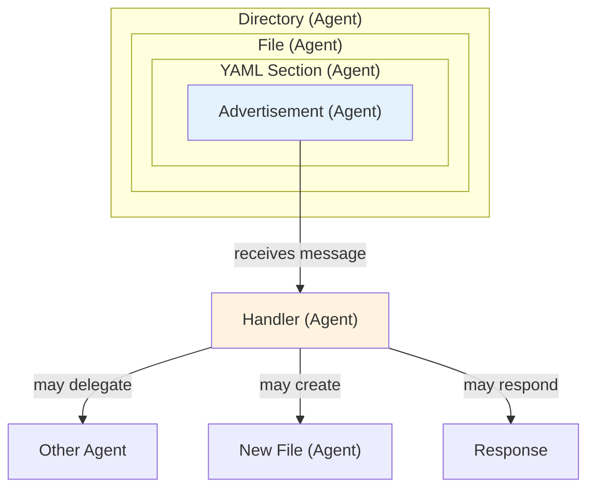
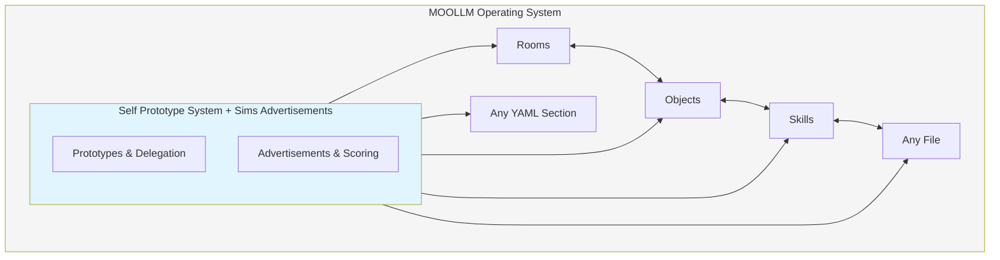

# MOOLLM Kernel Architecture

> *"The orchestrator is the Operating System. The LLM is the Coherence Engine. The Repo is the Microworld."*

---

## Overview

This document captures the **philosophy and design rationale** behind the MOOLLM kernel. The kernel itself (`kernel/`) contains lean operational files; this document explains *why* they work the way they do.

**Current workflow:** Don uses Copilot in VS Code. Start with the
[Copilot driver](drivers/copilot.yml). Cursor remains a supported host, but
its session database, rules files, and inspection tools are not Copilot
interfaces. Host capabilities must be checked in the current session.

**See also:**
- `README.md` — Kernel quick reference (this directory)
- `drivers/README.md` — Driver structure
- `../skills/skill/SKILL.md` — How skills relate to kernel

---

## The Three Layers

| Layer | Responsibility |
|-------|----------------|
| Skills | Rooms, characters, advertisements, games, and application behavior |
| Kernel protocols | Tool use, context selection, persistent state, repair, and logging conventions |
| Model and host | Model inference, supplied context, tool execution, permissions, and session lifecycle |

The kernel provides **infrastructure**, not **semantics**. It doesn't know what "rooms" or "soul chat" mean — that's userland's job.

---

## Orchestrator Types: Smart vs Generic

### The Core Distinction

**Generic Orchestrators** (such as Copilot in VS Code, Cursor, and ChatGPT,
without a MOOLLM-specific integration):
- Cannot parse MOOLLM-specific files
- Don't understand CARD.yml advertisements
- Can't inject ambient skills automatically
- The LLM must manually manage context

**Smart Orchestrators** (like MOOCO, custom implementations):
- Parse CARD.yml advertisements directly
- Inject ambient skills invisibly into context
- Manage hot/cold/working-set operationally
- Keep administrative infrastructure out of LLM's context window

### The Magic Dictionary Analogy

Smart orchestrators work like **NeWS PostScript magic dictionaries**:

In NeWS (Network extensible Window System), PostScript dictionaries like `processes`, `canvases`, and `events` appeared to be normal data structures but were actually backed by the window system. Reading from them triggered system queries; writing to them triggered system calls. The code didn't need to know — it just manipulated dictionaries.

Similarly, a smart MOOLLM orchestrator:
- Reads `CARD.yml` advertisements and activates matching skills
- Watches `hot.yml` / `working-set.yml` for context hints
- Injects ambient skills without the LLM explicitly requesting them
- Makes edits to these files "magically effect" orchestrator behavior

The **same skill files work on both orchestrator types** — the mechanism adapts:
- On generic orchestrators: LLM reads files manually, self-manages context
- On smart orchestrators: Orchestrator reads files, injects automatically

### Advisory Mode vs Operational Mode

| Feature | Generic (Advisory) | Smart (Operational) |
|---------|-------------------|---------------------|
| `hot.yml` | Documentation of what SHOULD be prioritized | Actually loaded into context |
| `cold.yml` | Breadcrumbs for archaeology | Actually evicted from context |
| `working-set.yml` | Self-documentation | Active context manifest |
| Ambient skills | LLM must manually load | Injected invisibly |
| CARD advertisements | Read on demand | Parsed and activated |

### Reverse Generation Pattern

On generic orchestrators, these files can work **in reverse**:
- Instead of commanding what to load, they record files explicitly read or requested
- Generate them to reflect what the orchestrator's attention is focused on
- These records are partial: they do not reveal the host's complete hidden context

---

## Driver Architecture

### What Drivers Do

Drivers adapt the MOOLLM constitution to specific orchestrators — like OS drivers adapt to different hardware.

A driver specifies:
1. **Detection** — How to identify this orchestrator
2. **Capabilities** — What features are available
3. **Tools** — Mapping abstract operations to concrete tool names
4. **Paths** — Where to store session files
5. **Adaptations** — Fallbacks for unsupported features
6. **Limits** — Token limits, file limits, etc.

### Driver Tiers

| Tier | Description | Example |
|------|-------------|---------|
| 1 | Minimal — bare essentials | `generic.yml` |
| 2 | Basic — read/write/terminal | Basic CLI |
| 3 | Standard — search, some MCP | ChatGPT |
| 4 | Advanced — file operations, search, execution; integrations vary | Copilot in VS Code, Cursor |
| 5 | Premium — custom tools, full MCP | Claude Code, Antigravity |
| 6 | Custom — full kernel control | MOOCO |

### Capability Graceful Degradation

When a feature isn't available, drivers specify fallbacks:

| Feature | Full Support | Fallback |
|---------|-------------|----------|
| `why` parameter | Include in tool call | Document intent in response |
| Append-only | Enforced by orchestrator | Convention only |
| Event logging | Structured YAML | Markdown narrative |
| Vector search | `SemanticSearch` | Grep/manual scan |
| Sandboxed exec | Isolated container | Trust-based |

---

## Context Assembly

### The Problem

LLMs are stateless — they don't remember previous turns unless you include them in the prompt. The orchestrator must **assemble context** from:
- Conversation history
- File contents
- Search results
- Tool outputs
- Session state

### MOOLLM's Approach

The kernel provides **context assembly protocol** (`kernel/context-assembly-protocol.md`):

1. **Working Set** — Files currently relevant
2. **Hot Cache** — High-priority items to keep loaded
3. **Cold Cache** — Items recently evicted (breadcrumbs)
4. **Summaries** — Compressed representations of large content

On generic orchestrators, these are **advisory** — the LLM consults them to remind itself what to load. On smart orchestrators, they're **operational** — the orchestrator reads them and assembles context automatically.

---

## Memory Management

### Hot/Cold Model

Inspired by CPU cache hierarchies:

| Record | Purpose | Copilot behavior |
|--------|---------|------------------|
| Context window | Inputs supplied to the current model call | Host-managed; complete contents and limits are not exposed |
| `.moollm/hot.yml` | Priorities for subsequent reads | Advisory; does not pin content in the model |
| `.moollm/working-set.yml` | Relevant file references | Advisory; not a complete context manifest |
| `.moollm/cold.yml` | References to revisit if needed | Does not evict content from Copilot |
| Repository files | Persistent definitions and state | Read explicitly when needed |

### Resolution Hints

Skills can declare **resolution levels** in their CARD.yml:
- `activation_only` — Just check if skill applies
- `summary` — Read CARD.yml header
- `interface` — Read CARD.yml fully
- `implementation` — Read SKILL.md
- `full` — Read everything including README.md

This lets the LLM (or orchestrator) know how deep to page in.

---

## Ambient Skills

### What Are Ambient Skills?

Skills that should be **always present** in context, continuously influencing behavior. Examples:
- `no-ai-slop` — Suppress filler language
- `yaml-jazz` — Treat YAML comments as semantic data
- `representation-ethics` — Guidelines for simulating real people

### The Injection Problem

On generic orchestrators, the LLM must:
1. Know that ambient skills exist
2. Remember to load their CARD.yml
3. Keep them in hot.yml for persistence
4. Re-load them if context is cleared

On smart orchestrators:
1. Orchestrator parses CARD.yml advertisements
2. Finds skills with `type: AMBIENT`
3. Injects them into every context assembly
4. LLM never has to think about it

### Same Files, Different Mechanism

The beauty: **same CARD.yml works both ways**:

```yaml
# In any skill's CARD.yml
advertisements:
  - trigger: "*"           # Matches everything
    score: 0.3             # Low but always present
    type: AMBIENT          # Smart orchestrators auto-inject
    resolution: summary    # Just the header
```

- Generic orchestrator: LLM reads this, knows to keep it loaded
- Smart orchestrator: Parses this, auto-injects skill

---

## Copilot in VS Code: startup and context

The current workflow uses the [Copilot driver](drivers/copilot.yml).
It describes file access, search, terminal tools, and advisory context records.
Actual tool names and permissions depend on the host and session; the driver
is not a guarantee that every integration is available.


### Startup

1. Identify the host from its supplied identity and available tools.
2. Read the matching driver and follow instructions actually supplied by the host.
3. Use the [bootstrap skill](../skills/bootstrap/SKILL.md) to find the relevant
   kernel protocols and skill descriptions.
4. Consult existing working-set and priority records where applicable.
   Do not replace unrelated session state.
5. Read the files needed for the task. Merely listing a skill does not load
   its contents.

Copilot manages its own context assembly. The model can request file reads
and maintain references, but cannot assume that a file remains in context
indefinitely or that it can inspect the complete hidden prompt.

### Persistent records and instructions

| Item | Purpose | Limit |
|------|---------|-------|
| Host-supplied instructions | Rules applicable to the current session | Use the supported host mechanism; Cursor configuration is not portable |
| Skill cards and protocols | Capability descriptions and detailed instructions | Read them when relevant; no automatic MOOLLM advertisement selection is assumed |
| `.moollm/hot.yml` | Priority references | Does not pin content in Copilot |
| `.moollm/working-set.yml` | Record of relevant files | Not a complete record of host context |
| `.moollm/cold.yml` | References that may be useful later | Does not control eviction |
| Saved summaries and examples | Continuity and reusable guidance | Follow host storage rules; review before sharing or committing |

Repository guidance intended for future sessions must be saved through an
instruction mechanism the host supports or explicitly read on startup.
Writing arbitrary YAML does not make Copilot consume it automatically.

### Session inspection

Use conversation, session, and tool-history interfaces only when the current
host exposes them. They may help explain which files were read and which
actions occurred. They do not provide access to model weights, complete
internal reasoning, or an exact inventory of retained context.

Cursor's LevelDB history and `.cursorrules` are not Copilot interfaces.
The [cursor-mirror skill](../skills/cursor-mirror/SKILL.md) remains available
for Cursor-specific work; its commands must not be presented as Copilot
commands or as required MOOLLM startup steps.

### Other hosts

Keep host-specific behavior in the [drivers](drivers/README.md). Cursor,
Claude Code, and other hosts can use the same MOOLLM files through different
tools and instruction mechanisms. A custom integration may implement
automatic skill selection and context loading, but those capabilities must
be implemented and verified, not inferred from the presence of a driver.

---

## The Coherence Engine

The LLM isn't just generating text. It's:

1. **Computing Dependencies** — Figuring out what depends on what
2. **Cross-Checking State** — Verifying consistency against rules
3. **Refereeing Conflicts** — Resolving parallel agent disagreements
4. **Orchestrating Simulations** — Running many characters per call
5. **Maintaining Consistency** — Keeping the microworld coherent

The kernel provides the **infrastructure** for this; skills provide the **semantics**.

---

## The Universal Foundation: Agents All The Way Down

This is the **most fundamental architectural principle** in MOOLLM. Everything else builds on this.

### Self + Sims = MOOLLM's DNA

MOOLLM's operating system layer combines two powerful ideas:

| From Self (Ungar) | From The Sims (Wright) |
|-------------------|------------------------|
| Prototypes & delegation | Advertisements & scoring |
| Slots (named references) | Needs/motives drive selection |
| Message passing | Dithering for organic behavior |
| Everything clones | Everything advertises |

These aren't skill-specific features. They're the **microcode** everything runs on.

### Advertisements Are Everywhere

Skills have CARD files with advertisements — that's how skills work. But **any object, file, or YAML section can have advertisements**:

```yaml
# A room can advertise
examples/adventure-4/pub/ROOM.yml:
  advertisements:
    - name: "enter_pub"
      score: 0.8
      triggers: [drink, socialize, relax]

# A character can advertise
characters/cat-whiskers/CHARACTER.yml:
  advertisements:
    - name: "pet_cat"
      triggers: [pet, comfort, cute]

# A YAML section can advertise inline
inventory:
  magic_sword:
    advertisements:
      - name: "attack_with_sword"
        triggers: [combat, fight]
```

### Events Don't Require Reification

An advertisement is an **event handler** — but the "event" doesn't have to exist as a file:

```yaml
# The "event" can be:
- A word in chat           # "feed the cat" triggers hunt_mouse
- A concept                # Player feels lonely → pet_cat scores higher
- A delegated method       # Another skill routes a message here
- A need state             # Hunger > 0.7 activates food-related ads
- Just... a message        # No file, no YAML, just intent
```

The handler can CHOOSE to materialize the event — or not:
- Just respond (no file created)
- Create YAML Jazz in same directory according to a schema
- Route to an inbox subdirectory
- Delegate to another skill
- Multiple dispatch (fan out to several handlers)

### Advertisements as Lexically Scoped Agents

An advertisement is a **lexically scoped agent** — bound to its directory context:

- **Captures environment** (the directory, the object's state)
- **Responds to patterns** (triggers)
- **Can create side effects** (files, messages, state changes)
- **Or just returns a value**

It's like a closure that receives messages and decides what to do.

### Agents All The Way Down



Every advertisement is a mini-agent. Every file containing advertisements is an agent. Every directory containing files is an agent. **Agents composed of agents** — Minsky's Society of Mind realized in filesystems.

### Skills Are Just Directories

Skills aren't special. They're directories that happen to have:
1. `CARD.yml` (interface/advertisements)
2. `SKILL.md` (detailed protocol)
3. Inherit from the same prototype system everything uses

**Anthropic skills embedded in MOOLLM gain all the nice things** that every directory and file already inherits:
- Prototype inheritance (from `parents:`)
- Advertisement discovery
- Path variable resolution
- Empathic linking

We didn't invent prototypes and advertisements **just for skills**. They're for **everything**. Skills just happen to use them well.

### Universal Composition



**Everything composes with everything else. Not just skills with skills.**

### The Heritage

| Concept | Origin | In MOOLLM |
|---------|--------|-----------|
| Prototypes | Self (Ungar) | Every directory can have `parents:` |
| Slots | Self | Every file is a slot in a directory |
| Delegation | Self | Resolution walks parent chain |
| Advertisements | The Sims (Wright) | Any object can advertise capabilities |
| Dithering | The Sims | Top-N + random for organic selection |
| Needs/Motives | The Sims | Context scores advertisements |
| Society of Mind | Minsky | Agents composed of agents |
| Actor Model | Hewitt/Agha | Everything is message passing |

**See also:** `designs/MOO-HERITAGE.md` for the full analysis including MOO/LambdaMOO lineage.

---

## Design Principles

### From Unix

- Simple tools that compose
- Text as universal interface
- Convention over configuration

### From Self Language

- Prototypes and delegation
- Objects clone, not instantiate
- Everything is mutable
- **Slots + messages = universal primitives** (see "Agents All The Way Down" above)

### From The Sims

- Advertisements signal capabilities
- Needs/motives score relevance
- Dithering prevents robotic behavior
- **Every object is an autonomous agent**

### From Minsky's Society of Mind

- Mind as society of simple agents
- Agents composed of agents
- K-lines activate constellations
- **The filesystem IS a distributed agent system**

### From Robust-First Computing (Dave Ackley)

- Missing state → repair, not crash
- Local information, global behavior
- Homeostatic maintenance

### From Kay/Papert

- Microworld as operating system
- The repo IS the world
- Learning through exploration

### From NeWS

- Magic dictionaries as system interface
- Code that doesn't know it's talking to the system
- Same API, different backing implementation

---

## File Organization (This Directory)

| File or directory | Purpose |
|-------------------|---------|
| [README.md](README.md) | Kernel quick reference |
| [constitution-core.md](constitution-core.md) | Shared principles |
| [constitution-template.md](constitution-template.md) | Constitution template |
| [context-assembly-protocol.md](context-assembly-protocol.md) | Context selection |
| [memory-management-protocol.md](memory-management-protocol.md) | Persistent context records |
| [event-logging-protocol.md](event-logging-protocol.md) | Event logging |
| [self-healing-protocol.md](self-healing-protocol.md) | Repair and recovery |
| [tool-calling-protocol.md](tool-calling-protocol.md) | Tool-use conventions |
| [naming/](naming/) | Naming documentation |
| [drivers/](drivers/) | Host adapters |
| [drivers/copilot.yml](drivers/copilot.yml) | Current Copilot workflow |
| [drivers/cursor.yml](drivers/cursor.yml) | Cursor-specific adapter |
| [drivers/claude-code.yml](drivers/claude-code.yml) | Claude Code adapter |
| [drivers/generic.yml](drivers/generic.yml) | Fallback adapter |
| [drivers/custom.yml](drivers/custom.yml) | Custom integration template |

---

## See Also

| Topic | Location |
|-------|----------|
| **Foundational** | |
| MOO/LambdaMOO heritage | `../designs/MOO-HERITAGE.md` |
| Directory as object | `DIRECTORY-AS-OBJECT.md` |
| Advertisement system | `../skills/advertisement/CARD.yml` |
| **Kernel** | |
| Kernel quick reference | `README.md` |
| Driver structure | `drivers/README.md` |
| Context assembly | `context-assembly-protocol.md` |
| Memory management | `memory-management-protocol.md` |
| Naming conventions | `naming/NAMING.yml` |
| **Skills** | |
| Skill architecture | `../skills/skill/SKILL.md` |
| CARD.yml format | `../skills/card/CARD.yml` |
| **Startup and host-specific inspection** | |
| Copilot capabilities and limits | [Copilot driver](drivers/copilot.yml) |
| Cursor-only session inspection | [cursor-mirror](../skills/cursor-mirror/SKILL.md) |
| Startup protocol | [bootstrap](../skills/bootstrap/CARD.yml) |
| **Orchestrators** | |
| Copilot driver | [drivers/copilot.yml](drivers/copilot.yml) |
| Cursor driver | [drivers/cursor.yml](drivers/cursor.yml) |
| MOOCO orchestrator | Orchestrator architecture (see orchestrator docs) |

---

*"Make the kernel boring so the skills can be exciting."*
