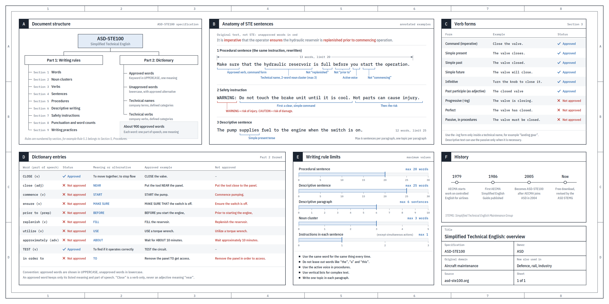

# STE80 Humanizer

[](https://skills.sh/Dodaios/ste80-humanizer) [](https://github.com/Dodaios/ste80-humanizer/actions/workflows/validate.yml) [](LICENSE)

STE80 Humanizer makes AI-written text read like a careful person wrote it, without changing what it says. It combines two methods:

1. **The humanizer method.** Remove the 26 tells from Wikipedia's [Signs of AI writing](https://en.wikipedia.org/wiki/Wikipedia:Signs_of_AI_writing), in the catalog of [blader/humanizer](https://github.com/blader/humanizer).
2. **Karpathy's STE80 method.** Rebuild the sentences "80% of the way to ASD-STE100", the controlled English of aircraft maintenance manuals.

**Before:**
> Great question! Kubernetes liveness probes are a powerful mechanism that enables the kubelet to determine whether a container is healthy — and it's not just a health check, it's your first line of defense. When a probe fails, the container will be automatically restarted by the kubelet, ensuring that your application remains available. However, it's important to note that misconfigured probes could potentially cause cascading restarts, so parameters like `initialDelaySeconds` and `failureThreshold` should be carefully tuned.
>
> Get this right, and your cluster heals itself.

**After:**
> A liveness probe tells the kubelet if a container is healthy. If the probe fails, the kubelet restarts the container. This keeps the application available.
>
> A bad probe can also cause many restarts. For example, a timeout that is too short makes healthy containers fail the probe. To prevent this, set `initialDelaySeconds` and `failureThreshold` to values that fit your application.

The goal is text that people read easily. Getting past AI detectors is not a goal.

## Why two passes

Most humanizers only remove phrases. The text loses "Great question!" and "seamless", but it keeps long sentences that carry three ideas, hide the actor and stack hedges. It still reads like AI. You can see it in the worked example in [SKILL.md](SKILL.md):

| Step | What is left |
|---|---|
| Original | Chatbot opener, dash, "not just X", "-ing" rider, "however", "could potentially", dramatic closer |
| After Pass 1 (tells) | "...the container will be automatically restarted by the kubelet, which keeps your application available. Misconfigured probes can cause cascading restarts, so parameters ... should be carefully tuned." Clean words, but heavy sentences. |
| After Pass 2 (STE80) | Short sentences, one idea each, active voice, the instruction apart from the description. |

## The method: what Karpathy said

On 2 October 2026, [Andrej Karpathy posted](https://x.com/karpathy/status/2105819303471976479) tips for one problem: as LLMs do more of the work, people spend more time reading and understanding what the models produce. His first tip:

> Ask your LLM to explain something in ASD-STE100, it's a controlled language specification originally developed for aerospace maintenance documentation. LLMs well-versed in this language and it comes with heavy constraints on clean writing style that I often find a lot more readable. Sometimes I've tried to soften it a bit e.g. ask for "80% of the way to ASD-STE100" because the spec is quite stringent.

The post then goes up a ladder: diagrams, then HTML pages, then explainer videos. His conclusion is that our work moves "up the abstractions into oversight and understanding". Clear output is the bottleneck, and writing is the first step.

[](assets/ste100-overview.png)

*The STE overview graphic from [Karpathy's post](https://x.com/karpathy/status/2105819303471976479). Click to enlarge. Note: a later fact check found errors in the dictionary panel (D). In ASD-STE100 Issue 9, "approximately" is approved, "TEST" is approved only as a noun (not as a verb), and there is no entry for "in order to". This skill follows Issue 9.*

**ASD-STE100** (Simplified Technical English) is from the 1980s aerospace industry. It was made for mechanics whose first language is not English, because a misread step on an aircraft can kill. Its rules:

- 20 words per instruction and 25 per description
- one instruction per sentence
- active voice and simple tenses
- one meaning per word, with about 900 approved words
- one topic per paragraph, and six sentences at most

**Why "80%"?** At 100%, "check" and "test" are nouns only, "may" and "should" are banned and many common words are not allowed. Normal prose sounds stiff. At 80%, you keep the full structure and only as much vocabulary as still sounds natural:

| STE rule | 100% (Strict mode) | 80% (default) |
|---|---|---|
| Sentence length 20 / 25 | Hard limit | A few words over is fine |
| One idea per sentence | Always | Always |
| Active voice, simple tenses | Always | Always |
| Approved dictionary only | Yes | No, use the plain common word |
| "check", "test" as verbs | No | Yes |
| "may", "should" | No | Yes, for real uncertainty |
| Contractions | No | Yes, in casual text |
| Semicolons | No | No |

Karpathy's tip is about readability. It does not remove chatbot phrases, so Pass 1 does that first.

## How to read the skill

[SKILL.md](SKILL.md) has two numbered lists:

- **§1 to §26:** the AI tells (Pass 1).
- **S1 to S15:** the STE80 structure rules (Pass 2).

Both lists are compact tables with a short example. Pass 2 says what changes between **80%** and **Strict**. The full entries, with **Watch for**, **Problem**, **Before** and **After**, are in [references/ai-tells.md](references/ai-tells.md) and [references/ste80-rules.md](references/ste80-rules.md). *Weak alone* means: act only if other tells are near. The skill reports its edits by number, for example "§1, §8, S2", so you can look each one up.

## Installation

Once installed, the skill answers to `/ste80-humanizer`. It also starts by itself when you ask to humanize, simplify or de-AI a text, or ask for STE.

### Any agent (skills.sh)

```bash
npx skills add Dodaios/ste80-humanizer
```

Global install for one agent, or for all of them:

```bash
npx skills add Dodaios/ste80-humanizer --global --agent claude-code
npx skills add Dodaios/ste80-humanizer --global --agent codex
npx skills add Dodaios/ste80-humanizer --global --agent cursor
npx skills add Dodaios/ste80-humanizer --global --agent '*'
```

Without `--global`, the skill goes into the current project only. The [skills CLI](https://github.com/vercel-labs/skills) from Vercel works with Claude Code, Codex, Cursor, OpenCode and many more agents.

### Claude Code plugin

```
/plugin marketplace add Dodaios/ste80-humanizer
/plugin install ste80-humanizer@ste80-humanizer
```

### Claude.ai and Claude Desktop

Download this repo as a ZIP (Code → Download ZIP). Upload it in Settings → Capabilities → Skills.

## Usage

```
/ste80-humanizer
<paste text>
```

Or just ask:

```
This sounds like ChatGPT wrote it. Make it sound like a person.
Rewrite this README 80% of the way to ASD-STE100.
Explain how TLS handshakes work in STE.
Light touch: just remove the AI stuff from docs/intro.md.
Convert docs/runbook.md to strict STE.
Does this email sound like AI? Just tell me, don't rewrite it.
```

| Mode | When | What it does |
|---|---|---|
| **Humanize (default)** | Normal requests | Pass 1 fully, Pass 2 at 80%. Keeps your voice. |
| **Light** | "light touch", "just remove the AI stuff" | Pass 1, plus only the worst sentences from Pass 2. |
| **Strict STE** | "strict", "full STE", procedures, safety notes | Pass 1 and all of Pass 2 at 100%. |

**Match your voice.** Add a sample of your own writing. The skill then matches your sentence length, words and punctuation.

**Fidelity first.** The skill keeps every fact, keeps "may" as "may", keeps "40+" as "40+", adds nothing and flags contradictions in the source. In our tests, this was the clearest difference from a plain prompt (see Tests).

## Pass 1: the 26 AI tells

| # | Tell | Before | After |
|---|---|---|---|
| **A. Staging instead of stating** ||||
| 1 | **Not X but Y** | It's not just a faster build tool, it's a new way to think. | The build tool caches each step. |
| 2 | **One-line closers** | ...No cold starts. No excuses. That's the power of the edge. | Latency dropped to 40 ms. |
| 3 | **Sayings that sound deep** | At its core, observability is the language of trust. | Shared dashboards show both teams the same data. |
| 4 | **Staged run-up** | Let's dive in. Here's what you need to know. | The API allows 100 requests per minute. |
| 5 | **Arguing with no one** | To be clear, I'm not saying microservices are bad... | We split the billing service out first. |
| **B. Rhythm by rule** ||||
| 6 | **Forced triads** | fast, intuitive, and powerful | loads in under a second |
| 7 | **Repeated openings** (*weak alone*) | It reads... It checks... It starts... | It reads the config and checks the schema. |
| 8 | **Dashes everywhere** | The migration — which took six weeks — is done. | The migration took six weeks and is done. |
| 9 | **Stacked qualifiers** (*weak alone*) | could potentially possibly cause | can break |
| 10 | **Hyphenated pairs** (*weak alone*) | The API is well-documented. | The API is well documented. |
| 11 | **Passive, missing subjects** (*weak alone*) | No account needed. | You do not need an account. |
| **C. Inflation and borrowed authority** ||||
| 12 | **Overused AI words** | leverages a robust caching layer, showcasing... | caches API responses on the device |
| 13 | **Inflated significance** | marks a pivotal moment in the project's journey | adds a CLI and drops Node 16 |
| 14 | **Vague association** | The outage was linked to the DNS change. | The DNS change caused the outage. |
| 15 | **Shallow -ing riders** | ..., highlighting its commitment to accessibility | (cut) |
| 16 | **Sales language** | our groundbreaking, world-class editor | The editor runs inside VS Code. |
| 17 | **Borrowed authority** | Experts agree... featured in TechCrunch, Wired... | It was on the front page of Hacker News in May. |
| 18 | **Avoiding is / has** | serves as the central hub and boasts 40 options | holds the settings. It has 40 options. |
| **D. Formatting by rule** ||||
| 19 | **Bold as decoration** | **Performance:** Performance has been improved. | The release makes pages load faster. |
| 20 | **Decorative headings** | ## 🚀 Getting Started With The CLI → | ## Install the CLI |
| 21 | **Curly quotes** (*weak alone*) | “true” | "true" |
| **E. Leftovers from the chat and the draft** ||||
| 22 | **Chatbot residue** | Great question! ... I hope this helps! | (cut the wrapper) |
| 23 | **Knowledge-limit hedges** | While details are limited, it was likely created around 2015. | The sources do not say. |
| 24 | **Heading repeated** | ## Security / Security is important. | (cut the line) |
| 25 | **Writing about the document** | This function was added to replace the old approach... | This function looks up users in a hash map. |
| **F. Writing for the wrong reader** ||||
| 26 | **Re-explaining what the reader knows** | A reply that walks through the whole diagnosis first | Agreed. I'll switch the job to UTC. |

## Pass 2: the 15 STE80 rules

| # | Rule | 80% vs Strict |
|---|---|---|
| S1 | One idea per sentence | 80% allows two linked facts with "and" or "because" |
| S2 | Short sentences: 20 words (instructions), 25 (descriptions) | 80% allows a small overrun |
| S3 | Condition first: "If X, do Y." | Same |
| S4 | Do not drop words ("the", "a", "that") | 80% allows fragments in tables and headings |
| S5 | Lists for steps and complex content | Same |
| S6 | Active voice | Same |
| S7 | Simple tenses only | Same |
| S8 | Verbs, not nouns, no "-ing" chains | Strict: "check" and "test" are nouns |
| S9 | Honest modals: can, must, will | 80% keeps "may" and "should" for real doubt |
| S10 | Plain words, one meaning each, no phrasal verbs | 80% keeps natural words |
| S11 | One term per thing | Same |
| S12 | No noun stacks over three words | Same |
| S13 | One topic per paragraph, six sentences at most | Same |
| S14 | Procedure apart from description, warnings first | Same |
| S15 | Simple punctuation, no semicolons | Strict: also no contractions |

More examples: [references/ste80-rules.md](references/ste80-rules.md). Full strict rules and a checklist: [references/strict-mode.md](references/strict-mode.md). More than 100 plain-word swaps: [references/word-swaps.md](references/word-swaps.md).

## Checker

`scripts/ste_check.py` is a small Python linter with no dependencies. It flags many Pass 1 tells, such as not-X-but-Y, chatbot phrases, run-ups, fake depth, stacked hedges, vague authority and association, "-ing" riders, inflated claims, AI words, hyphen pairs and curly quotes. It also flags the measurable Pass 2 rules: sentence and paragraph length, semicolons, dashes, passive voice, perfect and progressive tenses, "-ing" forms and phrasal verbs.

```bash
python scripts/ste_check.py README.md
python scripts/ste_check.py --strict docs/runbook.md
cat draft.txt | python scripts/ste_check.py -
```

It is a heuristic, not an AI detector and not a compliance checker.

## Tests

`evals/` has four cases in the `claude plugin eval` format: a README rewrite, an explanation from scratch, a strict runbook and a casual LinkedIn post that does not mention STE. Run them with `claude plugin eval . --allow-tools Write,Edit,Bash`.

What we saw: when the prompt names ASD-STE100, the base model already gets the style mostly right. The skill made the difference in fidelity. In the LinkedIn rewrite, the run without the skill invented a quote and changed "40+ customers" to "40-odd". The run with the skill kept every fact. In the README rewrite, it kept "you may need to" and flagged a contradiction in the source. These are small tests, so treat them as a hint, not proof.

## Limits

- **STE is for clear explanatory text.** For fiction, speeches and brand copy, the skill does Pass 1 only.
- **STE is an English standard.** For other languages, the skill applies the tells and the structure rules, but not the English word lists.
- **"STE style" is not "STE compliant."** Compliance needs the official dictionary, trained writers and review.

## Sources and credits

- Andrej Karpathy on X, 2 October 2026: https://x.com/karpathy/status/2105819303471976479
- ASD-STE100 Issue 9 (2025): https://www.asd-ste100.org
- Wikipedia, [Signs of AI writing](https://en.wikipedia.org/wiki/Wikipedia:Signs_of_AI_writing) (WikiProject AI Cleanup)
- [blader/humanizer](https://github.com/blader/humanizer) by Siqi Chen (MIT). Pass 1 follows its 26-pattern catalog and order, with new examples. Its license notice is in [THIRD_PARTY_NOTICES.md](THIRD_PARTY_NOTICES.md).
- Hacker News discussion of STE skills (July 2026): https://news.ycombinator.com/item?id=49114639

## Disclaimer

This skill does not contain the ASD-STE100 specification or its dictionary. The STE rules are paraphrased and simplified. ASD-STE100 and Simplified Technical English are trademarks of ASD (AeroSpace, Security and Defence Industries Association of Europe). This project is not affiliated with or endorsed by ASD.

## License

[MIT](LICENSE)
