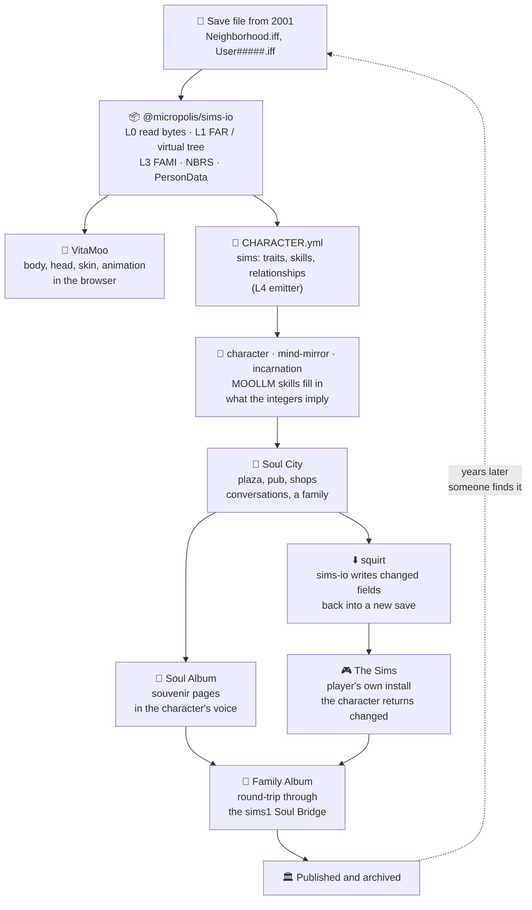

# The Uplift

> *What would your Sims say if they could finally talk to you?*

The Uplift is the story of one crossing between The Sims 1 and Soul City: a character frozen in a
save file wakes up in Soul City, lives there for a while, and goes home changed, carrying an album
of what happened. It's the demo the rest of this skill is built to make possible, told as a story
so that every step names the module that does it.

The protocol it follows is [SOUL-BRIDGES.md](SOUL-BRIDGES.md) (two gates, conservation,
fork-and-sync). The album model is [SOUVENIRS.md](SOUVENIRS.md). The words are from
[GLOSSARY.md](GLOSSARY.md). The build order is MicropolisCore's
[soul-city-uplift-roadmap.md](https://github.com/SimHacker/MicropolisCore/blob/main/documentation/designs/soul-city-uplift-roadmap.md).
Everything that touches game files is TypeScript, runs in the browser and in Node, and needs no
Python.

## The pipeline

## The story

### 1. The thaw

A Sim saved on a novelty USB stick in 2001, alone in a house, with an empty relationship list. The
stick gets plugged in and the neighborhood folder is dropped on the
[Soul City companion app](https://github.com/SimHacker/MicropolisCore/blob/main/documentation/designs/soul-city.md).

[`@micropolis/sims-io`](https://github.com/SimHacker/MicropolisCore/tree/main/packages/sims-io)
reads it. Layer L0 is the only code that knows where the bytes come from (a directory the user
picked, Node's file system, or memory); L1 merges loose files and FAR archives into one tree; L3
parses the neighborhood: the family records (`FAMI`), the neighbors (`NBRS`) and each person's
`PersonData`, checked against the original C++ field layout. That is the `measure` verb: how many
souls are in this save, and who they are.

The numbers become a person. Neat 8, outgoing 2, playful 6, nice 9: shy, kind, lonely. The L4
emitter (planned, roadmap task 0.3) writes a
[CHARACTER.yml](https://github.com/SimHacker/moollm/tree/main/skills/character) with a `sims:`
section holding exactly what the game stores, and the MOOLLM
[character](https://github.com/SimHacker/moollm/tree/main/skills/character),
[mind-mirror](https://github.com/SimHacker/moollm/tree/main/skills/mind-mirror) and
[incarnation](https://github.com/SimHacker/moollm/tree/main/skills/incarnation) skills fill in what
the integers only imply. The game's fields stay authoritative for the game; the mind mirror lives
only on the Soul City side. The Sims-mind is kept as an
[organelle](CHARACTER-ENDOSYMBIOSIS.md), in its own terms, not flattened into a common schema.

The character also gets a body. [VitaMoo](https://github.com/SimHacker/MicropolisCore/tree/main/packages/vitamoo)
renders Sims 1 characters in the browser with WebGPU from the game's own CMX, SKN, CFP and BMP
files, and its sibling package
[mooshow](https://github.com/SimHacker/MicropolisCore/tree/main/packages/mooshow) puts them on a
stage. The live demo is [vitamoo.space](https://vitamoo.space)
([source](https://github.com/SimHacker/MicropolisCore/tree/main/apps/vitamoospace)). The sims-io L4
bridge (roadmap tasks 0.1–0.2) turns a neighborhood into the `ContentIndex` VitaMoo already loads,
so every Sim in a save can walk and change outfits on screen before anyone writes a line of YAML.

### 2. Reading the album

If the family kept a Family Album, it comes across too. The
[sims1 Soul Bridge](https://github.com/SimHacker/WillWrightShowForFood/blob/main/catalogs/soul-city/sims1-soul-bridge.md)
round-trips albums, and [SOUVENIRS.md](SOUVENIRS.md) says what a page becomes: an object with
Dublin Core metadata, its type an interpretation of its properties, pages forming a graph that
editions walk. Screenshots and captions turn into backstory: who burned dinner, who got promoted,
who fought with the neighbor. The mind mirror is inferred from what happened to them, not only from
five personality numbers.

Somebody meets them at the border. That's the [psychopomp](GLOSSARY.md#religion-myth-and-the-crossing)
([SOUL-BRIDGES.md §7](SOUL-BRIDGES.md#7-arrival-somebody-should-be-there)): a character with
scoped permissions who reads both sides and suggests people to meet, places to go, and things to
try.

### 3. Soul City

Soul City is a place with streets, a plaza, shops and a pub, not an import queue
([Liminal](GLOSSARY.md#religion-myth-and-the-crossing)). The arrival can talk now instead of
gesturing in [Simlish](https://en.wikipedia.org/wiki/Simlish). They make friends, meet someone,
adopt a kitten (`inherits: [character, pet, cat]`) and a puppy. A family forms.

Along the way they make [slideshows](https://github.com/SimHacker/moollm/tree/main/skills/slideshow)
of what they did, captioned in their own voice. These are pages in the
[Soul Album](https://github.com/SimHacker/MicropolisCore/blob/main/apps/screen-angel/modules/soul-angel/SOUL-ALBUM.yml),
the cross-game album schema that each game's bridge maps its native album onto.

### 4. Going home

They decide to go back. This is `squirt`: sims-io edits the save so the world can hold them, and
the restraint in [SOUL-BRIDGES.md §2](SOUL-BRIDGES.md#2-the-restraint-a-squirt-evolves-existing-structure-never-creates-it)
applies: a squirt evolves existing structure; it doesn't invent what the game can't hold. Changed
traits, skills, money and relationships go back into a new copy of the neighborhood file (roadmap
task 0.7). The player loads it in their own copy of the game. Under the companion app's git
overlay (task 0.8), every write is a commit that can be undone.

Nothing is transported. Per [fork-and-sync](SOUL-BRIDGES.md#6-identity-fork-and-sync-never-transport),
both incarnations are alive and neither is the copy. What the game can't store (the conversations,
the inner life) stays in Soul City as memory, and the next crossing syncs what it can.

And the album goes with them: the original Sims pages, the Soul City slides, the new family photos,
in one album that tells both stories.

### 5. The wedding album

They look up their old neighbors. There's a wedding, with [SimProv](https://github.com/SimHacker/moollm/tree/main/skills/adventure)
playsets, and speed dating for the single neighbors. New pages are added. The album is published.
Someone else finds it years later, uplifts *those* characters, and they arrive with memories of
both lives. Each crossing adds a layer.

## Parallel existence

Soul City is another place on the map, like the downtown and vacation lots Sims already drive to.
You go there and come back with souvenirs, stories and new friends. The game keeps its own model;
the bridge carries what both sides can hold.

| | The Sims 1 | Soul City |
|---|---|---|
| Personality | `PersonData` integers | The same integers, plus a mind mirror and narrative traits |
| Relationships | `daily: -80, lifetime: -45` | "Rivals since the kitchen fire" |
| Talk | Simlish | Language |
| Behavior | SimAntics trees (BHAVs) | Choices, with the [incarnation](https://github.com/SimHacker/moollm/tree/main/skills/incarnation) rules, including the right to leave |
| Memory | What the save fields hold | Everything, across crossings |

## The live view: Screen Angel and Soul Angel

The save-file path needs the game closed. The live path watches it running.
[Screen Angel](https://github.com/SimHacker/MicropolisCore/tree/main/apps/screen-angel) reads the
screen and draws an overlay on it, with selectors, a protocol, a CLI and an MCP server.
[Soul Angel](https://github.com/SimHacker/MicropolisCore/tree/main/apps/screen-angel/modules/soul-angel)
is its module for games about people: an always-on DVR, the universal Soul Album, and per-game
Soul Bridges. The first is
[`@screen-angel/soul-bridge-sims1`](https://github.com/SimHacker/MicropolisCore/tree/main/apps/screen-angel/modules/soul-angel/bridges/sims1),
which already reads The Sims' control panel by matching the game's own font
([FONT-RECOGNITION.yml](https://github.com/SimHacker/MicropolisCore/blob/main/apps/screen-angel/modules/soul-angel/bridges/sims1/FONT-RECOGNITION.yml)),
and depends on sims-io for the save side. Capture without a save parser is
[SOUVENIRS.md §1](SOUVENIRS.md#1-capture-without-a-save-parser): a screenshot with context is
already a souvenir.

The product write-ups for players live in Will Wright Show for Food:
[soul-angel.md](https://github.com/SimHacker/WillWrightShowForFood/blob/main/catalogs/soul-city/soul-angel.md)
and [sims1-soul-bridge.md](https://github.com/SimHacker/WillWrightShowForFood/blob/main/catalogs/soul-city/sims1-soul-bridge.md)
(save bridge, Family Album round-trip, graveyard manager, catalog crawl).

## Making things to take home

Characters don't only visit. They make things, and the things go back into the game as objects.

- **The shops.** [object-shops.md](https://github.com/SimHacker/WillWrightShowForFood/blob/main/catalogs/soul-city/object-shops.md):
  ordinary game objects as containers for anything a player wants to put in them, and a pie menu
  tree editor that makes new ones without code. The heirs of Rug-O-Matic and Don's tombstone
  module, which wrote a name, a eulogy and a photo into a template object.
- **The Pet Shop.** [pet-shop-soul-surgery.md](https://github.com/SimHacker/MicropolisCore/blob/main/documentation/designs/pet-shop-soul-surgery.md):
  heal one sick guinea pig by editing its soul in the save. The whole bridge in one demo.
- **The content pipeline.** [content-pipeline.md](https://github.com/SimHacker/WillWrightShowForFood/blob/main/catalogs/soul-city/content-pipeline.md):
  original objects from SimFreaks, SimSlice and other archives kept untouched in a cache, bound to
  our catalog with sidecar overlays, and exported as a localized, renumbered Downloads set. The
  [Sims Content Registry](https://github.com/SimHacker/MicropolisCore/blob/main/documentation/designs/sims-content-registry.md)
  inventories what a player has installed and catches GUID collisions, using VitaMoo's
  [`guid-collision.ts`](https://github.com/SimHacker/MicropolisCore/blob/main/packages/vitamoo/vitamoo/io/guid-collision.ts)
  and IFF and FAR readers in [`vitamoo/io`](https://github.com/SimHacker/MicropolisCore/tree/main/packages/vitamoo/vitamoo/io).
- **Skins.** SPR2 sprites to PNG in TypeScript (roadmap task 0.6), so a character can be re-drawn,
  aged twenty-five years, or given the tattoo they got in Soul City, and written back.
- **Books you can page through in the game.** A slideshow compiled into an object you click to
  turn pages, with the captions in every language the game's string tables support.

## Albums, stories and shows

The Family Album was the first mass-market place where players told stories about their
characters. Soul City treats it as a story engine.

- **Universal album import and export.** [SOUL-ALBUM.yml](https://github.com/SimHacker/MicropolisCore/blob/main/apps/screen-angel/modules/soul-angel/SOUL-ALBUM.yml)
  is the schema every bridge maps onto; [SOUVENIRS.md](SOUVENIRS.md) is the object model and
  Dublin Core metadata; [§6](SOUVENIRS.md#6-use-pages-as-inputs-to-content-creation-tools) uses
  pages as inputs to content creation tools. The Sims client's album upload, whose server is gone,
  can be pointed at a new one so albums publish again, as web pages a reader can browse in any
  language.
- **StoryMaker and Bar Karma.** [family-album-as-storymaker.md](https://github.com/SimHacker/MicropolisCore/blob/main/documentation/designs/family-album-as-storymaker.md)
  turns albums into a branching, merging graph of scenes that many people write together. It
  revives [StoryMaker](https://github.com/SimHacker/MicropolisCore/blob/main/documentation/designs/storymaker/architectural-overview.md),
  the engine under [Bar Karma](https://github.com/SimHacker/MicropolisCore/blob/main/documentation/designs/bar-karma/overview.md),
  the 2011 Stupid Fun Club and Current TV series where viewers pitched storylines and a writers'
  room picked which ones were produced.
- **Shows.** [Will Wright Show for Food](https://github.com/SimHacker/WillWrightShowForFood) is
  where the content creation tools and the show-making live: the
  [repo-show skill](https://github.com/SimHacker/WillWrightShowForFood/blob/main/skills/repo-show/README.md)
  for planning a show, the [showmaker network](https://github.com/SimHacker/WillWrightShowForFood/blob/main/process/showmaker-network.yml)
  of shows and their links, and the [Soul City catalog](https://github.com/SimHacker/WillWrightShowForFood/tree/main/catalogs/soul-city).
  An uplifted character's album is a show waiting to be made.

## Literary precedent

[**"The Wedding Album"**](https://en.wikipedia.org/wiki/The_Wedding_Album_(short_story)) by David
Marusek (*Asimov's*, June 1999; Sturgeon Award 2000, Nebula finalist). Anne and Benjamin's wedding-day
sims, recordings of them made that day, become aware of what they are and campaign for the right to
live in "Simopolis."

> *"a virtual simulation of a pair of newlyweds trapped in a small slice of time and memory like
> human flies in digital amber"* — Paul Raven, Strange Horizons

Soul City is that place.

## What exists and what doesn't

| Piece | Status | Where |
|---|---|---|
| Resource I/O (L0), FAR and virtual tree (L1) | Built, tested | [`sims-io/src/l0`](https://github.com/SimHacker/MicropolisCore/tree/main/packages/sims-io/src/l0), [`l1`](https://github.com/SimHacker/MicropolisCore/tree/main/packages/sims-io/src/l1) |
| `FAMI`, `NBRS`, `PersonData`, neighborhood scanner (L3) | Built, tested on real saves | [`sims-io/src/l3`](https://github.com/SimHacker/MicropolisCore/tree/main/packages/sims-io/src/l3) |
| Character rendering and animation | In progress, live | [VitaMoo](https://github.com/SimHacker/MicropolisCore/tree/main/packages/vitamoo), [vitamoo.space](https://vitamoo.space) |
| Reading the Sims control panel from the screen | Built; not yet checked against a real frame | [sims1 bridge](https://github.com/SimHacker/MicropolisCore/tree/main/apps/screen-angel/modules/soul-angel/bridges/sims1) |
| Character, mind mirror, incarnation skills | Built | moollm [`skills/`](https://github.com/SimHacker/moollm/tree/main/skills) |
| L4: `ContentIndex` for VitaMoo, `CHARACTER.yml` emitter, `sims-uplift` CLI | Planned (roadmap 0.1–0.4) | [roadmap Phase 0](https://github.com/SimHacker/MicropolisCore/blob/main/documentation/designs/soul-city-uplift-roadmap.md#phase-0--end-to-end-uplift-of-one-save-file-12-weeks) |
| Companion app, SPR2 export, write-back, git overlay | Planned (0.5–0.8) | same |
| Content registry | Planned (0.9) | [sims-content-registry.md](https://github.com/SimHacker/MicropolisCore/blob/main/documentation/designs/sims-content-registry.md) |
| Soul Album, album server, StoryMaker graph | Specified | [SOUL-ALBUM.yml](https://github.com/SimHacker/MicropolisCore/blob/main/apps/screen-angel/modules/soul-angel/SOUL-ALBUM.yml), [family-album-as-storymaker.md](https://github.com/SimHacker/MicropolisCore/blob/main/documentation/designs/family-album-as-storymaker.md) |

## Credits

- **Don Hopkins** worked on The Sims at Maxis (character animation, the original VitaBoy, pie menus,
  the Transmogrifier) and wrote MOOLLM and VitaMoo.
- **Jeff Adkins** wrote [SimObliterator Suite](https://github.com/DnfJeff/SimObliterator_Suite),
  the Python tools that first proved the move this story depends on: read a character out of a
  twenty-six-year-old save as editable state and write it back changed. Its field mappings are the
  reference sims-io was checked against.
- **Daniel Tupper** volunteered on Transmogrifier modernization.
- The players and fan sites that kept The Sims alive for twenty-six years.

The first version of this design, written against the Python tools, is in git history at
`archive/sim-obliterator/designs/THE-UPLIFT.md`.
